  

# Awesome Autonomous Penetration Testing &amp; Security Swarms 🛡️🤖

  
  
  
  
  
  

> **A curated collection of top autonomous penetration testing platforms, continuous security validation tools, AI red teaming frameworks, and multi-agent security swarms — with an emphasis on open-source, self-hosted solutions.** 🌟

Autonomous penetration testing and multi-agent security swarms utilize artificial intelligence (AI agents, LLMs, and reactive reasoning loops) to automate reconnaissance, attack-surface discovery, exploit validation, vulnerability chaining, and remediation reporting with minimal human intervention. 

While enterprise continuous threat validation is historically dominated by commercial SaaS platforms (Horizon3.ai NodeZero, Pentera, SafeBreach), a flourishing ecosystem of open-source projects now enables engineering teams to deploy local, sandbox-isolated autonomous pentest agents, swarm coordination engines, and LLM-powered red teams.

---

## 📑 Table of Contents

- [📊 Sector Overview &amp; Market Dynamics](#-sector-overview--market-dynamics)
- [🏢 SaaS / Hosted Platforms](#-saas--hosted-platforms)
- [💻 Open-Source GitHub Projects](#-open-source-github-projects)
  - [⚡ Autonomous Swarms &amp; Pentest Platforms](#-autonomous-swarms--pentest-platforms)
  - [🤖 LLM-Driven Pentest Agents &amp; Offensive MCPs](#-llm-driven-pentest-agents--offensive-mcps)
  - [🛠️ Supporting Security Frameworks &amp; Simulators](#️-supporting-security-frameworks--simulators)
- [⭐ Star History](#-star-history)
- [🤝 How to Contribute](#-how-to-contribute)
- [💖 Support &amp; Sponsorship](#-support--sponsorship)
- [⚠️ Disclaimer](#️-disclaimer)

---

## 📊 Sector Overview &amp; Market Dynamics

The global market for proactive cyber defense is experiencing rapid growth, driven by compliance mandates (NIS2, DORA, PCI-DSS 4.0) and the necessity for machine-speed vulnerability discovery:
- **Penetration Testing Market**: Valued at **$2.5B–$3.1B** with a projected CAGR of **14%–16.6%**.
- **Breach &amp; Attack Simulation (BAS) Market**: Valued at **$600M–$1.1B** with an explosive projected CAGR of **22%–27%+**.
- **Market Concentration**: The space is currently **moderately fragmented**. High-growth AI-native pure-plays lead autonomous testing innovation, while larger security conglomerates (CrowdStrike, Palo Alto Networks, IBM) are actively consolidating the sector by integrating continuous automated validation directly into XDR and exposure management portfolios.

---

## 🏢 SaaS / Hosted Platforms

Leading commercial autonomous penetration testing, breach-and-attack simulation, and continuous security validation platforms:

| Company / Platform | Company Size (Valuation / Revenue) | Pricing (Starting Tier) | Free Tier / Trial Limits | Description |
| :--- | :--- | :--- | :--- | :--- |
| **[Horizon3.ai NodeZero](https://www.horizon3.ai/)** | Valuation: ~$2.0B (Series E) / ARR: ~$100M+ | ~$18,600/year base (Core/Pro annual subscriptions scale at ~$50–$85/asset; on-demand Flex from ~$15/asset) | 1–2 week limited Proof of Value (PoV) trial upon request (internal/external network or AD scope) | Fully autonomous penetration testing platform that continuously discovers and validates exploitable attack paths. |
| **[Pentera](https://www.pentera.io/)** | Valuation: ~$1.0B+ (Series D) / ARR: ~$100M | ~$35,000/year starting baseline (average enterprise contracts ~$90k–$220k+/year based on asset count) | No self-serve free tier; custom Proof of Value (PoV) trial available upon enterprise consultation (limited scope/duration) | Automated security validation platform emulating real-world multi-stage attacker techniques across the attack surface. |
| **[NetSPI](https://www.netspi.com/)** | Funding / Scale: ~$500M raised ($410M KKR growth round) / Est. Revenue: ~$100M+ | ~$20,000–$30,000/year starting engagement for PTaaS/ASM (scales with target scopes and application size) | No public free tier or free trial; guided Proof of Concept (PoC) and live platform walkthroughs upon sales consultation | Enterprise penetration testing, continuous attack surface management (ASM), and PTaaS via Resolve™. |
| **[HackerOne](https://www.hackerone.com/)** | Valuation: ~$841M (Series E) / Est. ARR: ~$75M–$100M | ~$15,000–$25,000/year base platform subscription (bounties funded separately; pentest credits add-on) | **Essential VDP Free Forever Tier** (free intake channel for vulnerability disclosure; no platform fees, self-managed) | Leading vulnerability disclosure, crowdsourced security, and AI-assisted pentesting/red-teaming platform. |
| **[Cymulate](https://cymulate.com/)** | Valuation: ~$500M (Series D) / Est. ARR: ~$30M–$35M | ~$1,500/feature/month (~$18,000/year baseline; standard multi-vector enterprise packages ~$50,000+/year) | No self-serve free tier; 14-day guided enterprise Proof of Concept (PoC) available upon request | Continuous security validation, breach and attack simulation (BAS), and exposure management platform. |
| **[AttackIQ](https://www.attackiq.com/)** | Valuation: ~$215M–$250M / Est. Revenue: ~$25M–$40M | AttackIQ Flex starting on-demand; annual Ready! and Enterprise validation tiers start at ~$25,000–$35,000/year | No self-serve free tier; limited-time guided Proof of Concept (PoC) trial on AWS Marketplace/sales evaluation | Security control validation and automated adversary emulation platform natively mapped to MITRE ATT&CK. |
| **[Cobalt.io](https://www.cobalt.io/)** | Funding: ~$50M+ / Est. ARR: ~$50M–$130M | ~$3,500 per autonomous test; annual credit bundles (1 credit = 8 hrs pentest) start at ~$30,000/year | No public free tier or trial; custom product demo and scoped pilot assessments upon request | Pentest-as-a-Service (PTaaS) platform blending on-demand human ethical hacking credits with automated testing. |
| **[Picus Security](https://www.picussecurity.com/)** | Valuation: ~$120M–$150M+ ($84M funded) / Est. ARR: ~$40M–$45M | ~$20,000–$30,000/year base deployment (varies by monitored network gateways and endpoints) | No self-serve free tier; guided enterprise Proof of Concept (PoC) available upon sales consultation | Automated Breach and Attack Simulation (BAS) and adversarial exposure validation (AEV) platform. |
| **[SafeBreach](https://www.safebreach.com/)** | Funding: ~$106.5M (Series D) / Est. ARR: ~$21M–$33M | ~$50,000/year starting baseline tier (scales by number of deployed simulators, endpoints, and cloud connectors) | No self-serve free tier; tailored enterprise Proof of Concept (PoC) trial arranged with sales engineering | Continuous Breach and Attack Simulation (BAS) platform simulating comprehensive multi-vector adversary playbooks. |
| **[BreachLock](https://www.breachlock.com/)** | Funding: ~$3M (Seed) / Est. Revenue: ~$10M–$15M | $2,500 for one-time validation; annual continuous security validation starting from $5,000/year | No self-serve free tier; free live interactive product demo and scoped testing walkthroughs upon request | Full-stack Continuous Threat Exposure Management (CTEM) combining AI-driven scanning with PTaaS human validation. |

---

## 💻 Open-Source GitHub Projects

Curated open-source repositories and self-hostable autonomous security agents, sorted by GitHub Stars_Count (descending). Each tool should strictly be executed inside sandbox environments against authorized targets.

### ⚡ Autonomous Swarms &amp; Pentest Platforms

- **[vxcontrol/pentagi](https://github.com/vxcontrol/pentagi)** (PentAGI)   
  *Fully autonomous multi-agent system for end-to-end penetration testing.* Features specialized collaborative agents (planner, researcher, pentester, coder, reporter) coordinating 20+ professional tools (nmap, Metasploit, sqlmap) in isolated Docker environments. Maintains long-term vector memory, provides Web UI/REST/GraphQL APIs, and supports both commercial and local Ollama LLMs. (MIT License)

- **[apache/caldera](https://github.com/apache/caldera)**   
  *Automated adversary emulation and autonomous red-team platform by MITRE.* Built directly upon the MITRE ATT&amp;CK framework, Caldera automates complex breach-and-attack simulation profiles, autonomous agent actions, and operational security testing. (Apache-2.0 License)

- **[guardicore/monkey](https://github.com/guardicore/monkey)** (Infection Monkey)   
  *Open-source breach and attack simulation (BAS) tool for continuous testing.* Autonomously tests internal network resilience, laterally propagates to validate network segmentation, and evaluates adherence to Zero Trust frameworks without disrupting production assets. (GPL-3.0 License)

- **[jiwoochris/artex-global](https://github.com/jiwoochris/artex-global)** (ARTEX)   
  *Multi-agent autonomous penetration testing framework.* Employs specialized LLM-driven agents executing targeted recon, active exploitation, and vulnerability reporting with multi-language and containerized test execution support. (AGPL-3.0 License)

- **[Armur-Ai/Pentest-Swarm-AI](https://github.com/Armur-Ai/Pentest-Swarm-AI)**   
  *Autonomous multi-agent security swarm engine for web application &amp; API pentesting.* Coordinates asynchronous agents via a stigmergic blackboard with pgvector memory and ReAct loops. Enforces deterministic non-LLM oracle verification of findings before logging. (AGPL-3.0 License)

- **[s0ld13rr/pentestcode](https://github.com/s0ld13rr/pentestcode)**   
  *Multi-agent CLI offensive security framework.* Features persistent engagement state machines, specialized sub-agents (recon, scanner, enumerator, Active Directory exploiter, reporter), and autonomous tool dispatching. (GPL-3.0 License)

---

### 🤖 LLM-Driven Pentest Agents &amp; Offensive MCPs

- **[GreyDGL/PentestGPT](https://github.com/GreyDGL/PentestGPT)**   
  *Pioneering LLM-empowered automated penetration testing agent (USENIX Security 2024).* Structures testing into hierarchical modules (reasoning, generation, parsing) to conduct multi-stage attacks with contextual persistence. (MIT License)

- **[0x4m4/hexstrike-ai](https://github.com/0x4m4/hexstrike-ai)**   
  *Advanced offensive Model Context Protocol (MCP) server for autonomous agents.* Bridges LLMs and agent frameworks directly to 150+ command-line cybersecurity tools (nmap, nuclei, ffuf, hydra, metasploit) for automated exploitation and bug hunting. (MIT License)

- **[google/mantis](https://github.com/google/mantis)**   
  *Modular AI framework by Google for discovering, reproducing, and patching vulnerabilities.* Coordinates automated exploration agents to test targets and validate remediation with verifiable code patches. (Apache-2.0 License)

- **[xalgorix/xalgorix](https://github.com/xalgorix/xalgorix)**   
  *Autonomous 22-phase web and API penetration testing agent.* Employs automated exploit verification to eliminate false positives and compiles detailed CVSS-scored remediation reports. (AGPL-3.0 License)

- **[Vasco0x4/AIDA](https://github.com/Vasco0x4/AIDA)**   
  *Autonomous penetration testing agent wrapped in Docker isolation.* Interactively executes tool pipelines, logs exact reproduction payloads, and incorporates human-in-the-loop validation checkpoints. (GPL-3.0 License)

---

### 🛠️ Supporting Security Frameworks &amp; Simulators

- **[OWASP/Nettacker](https://github.com/OWASP/Nettacker)**   
  *Automated penetration testing and vulnerability scanning framework.* Frequently integrated into agent execution pipelines for high-throughput service enumeration, network reconnaissance, and CVE validation. (Apache-2.0 License)

- **[redcode-labs/Coldfire](https://github.com/redcode-labs/Coldfire)**   
  *Golang malware development &amp; adversary simulation framework.* Provides building blocks for autonomous agent execution loops including evading controls, process manipulation, and reconnaissance primitives. (MIT License)

> 💡 **Best Practice Tip**: For full swarm autonomy, explore **PentAGI** and **Pentest-Swarm-AI**. For modular agent tooling and MCP orchestration, integrate **hexstrike-ai**. Always execute autonomous offensive agents within dedicated network namespaces or ephemeral containers with human supervision.

---

## 📈 Star History

---

## 🤝 How to Contribute

Contributions are warmly welcomed! Please help grow and refine this resource:

1. 🍴 **Fork the repository**
2. 🌿 **Create a feature branch**: `git checkout -b feature/new-security-agent`
3. 📝 **Add your entry** under the correct section in alphabetical or categorized order.
4. 📌 **Follow the template**: `[Owner/Repo](URL)  — Description (License)`
5. 🛡️ Ensure the tool focuses strictly on authorized security testing and research.
6. 🚀 **Submit a Pull Request** with a clear explanation of the platform.

---

## 💖 Support &amp; Sponsorship

If you find this repository valuable, consider supporting the continued curation and maintenance of open-source cybersecurity resources:

- ⭐ **Star this repository** to improve visibility across the cybersecurity community!
- 🍴 **Fork and share** with fellow security researchers, red-teamers, and AI engineers.
- ☕ **Buy me a coffee**: Support ongoing work via the [Sponsor Dashboard](https://github.com/sponsors/ishandutta2007).

Thank you for supporting open-source security tools! 🙌

---

## ⚠️ Disclaimer

This repository is curated strictly for educational, defensive, and authorized research purposes:

- **Strict Authorization Required**: Autonomous penetration testing tools must **only** be deployed against systems, networks, and environments where you have explicit, written authorization from the asset owner.
- **Legal Compliance**: Unauthorized network exploitation, scanning, and penetration testing violate local and international laws (such as the Computer Fraud and Abuse Act - CFAA) and carry criminal and civil liability.
- **Operational Safety**: AI agents executing real shell commands can alter system configurations, fill databases, or cause service downtime. Always deploy autonomous swarms in isolated staging environments or sandboxes with audit logging and emergency kill switches.
- **Maintainer Limitation**: The curators and contributors assume no liability for misuse, damages, or unintended disruptions caused by any listed tool.

---

  <b>Built with ❤️ for the global open-source cybersecurity &amp; AI community.</b> 
  Always test ethically and responsibly.

